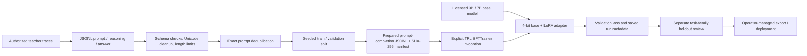

# Reasoning Model Distillation & SLM Fine-Tuning Pipeline

An end-to-end starter for validating teacher reasoning traces, preparing reproducible train/validation JSONL splits, fine-tuning an authorized 3B/7B causal model with LoRA/QLoRA using Hugging Face TRL, and recording evaluation metadata. It does not generate teacher traces or run training automatically. Training happens only when an operator runs the explicit command below.

The example stores a concise rationale in `<think>` tags followed by a final answer. Treat teacher traces as sensitive and untrusted data. Use only outputs that you are permitted to store and use for training, and do not assume a distilled model will match its teacher without held-out evaluation.

## Workflow and architecture



## Input format

Create an authorized JSONL file with one JSON object per line:

```json
{"prompt":"Question or task","reasoning":"Short rationale from the teacher","answer":"Final answer"}
```

The preparation script requires at least two unique prompts, strips control characters, Unicode-normalizes, collapses whitespace, rejects oversized fields, removes duplicate prompts, and makes a seeded random split. Random row splitting does not prevent leakage between paraphrases or related tasks; group by task family before splitting for meaningful evaluation.

## Setup and commands

Use Python 3.11+, a compatible CUDA-enabled Linux environment, and enough GPU memory for the selected base model and sequence length. Install PyTorch according to the official CUDA instructions for your hardware, then install this repository's requirements.

```sh
python -m venv .venv
source .venv/bin/activate
pip install -r requirements.txt
```

Copy an authorized dataset to a private local path, then prepare it:

```sh
python -m app.prepare --input /path/to/authorized-traces.jsonl --output-dir data/processed --validation-fraction 0.05 --seed 42
```

Review `configs/train.yaml`, the base model's license, and the prepared split before explicitly starting training:

```sh
python -m app.train --config configs/train.yaml
```

The script saves a PEFT adapter, tokenizer, evaluation metrics, and run metadata under the configured output directory. It does not upload models or datasets. The sample configuration is illustrative and should be sized to the target GPU.

## Quality and safety controls

- Base model `trust_remote_code` defaults to false. Keep it false unless you have reviewed the model code.
- Inputs have file, record-count, field-length, schema, and duplicate checks.
- Adapter training uses a deterministic seed and validation split; metadata records the source manifest and measured trainer metrics.
- The metric from TRL validation is a training objective, not a reasoning-accuracy benchmark. Add task-specific answer checks on an independently curated holdout before making quality claims.
- Model and dataset licensing, privacy, consent, retention, and removal must be reviewed before use.
- Model artifacts and private data are ignored by Git.

See [data and model governance](docs/DATA_AND_MODEL.md), [development guide](docs/DEVELOPMENT.md), and [deployment guide](docs/DEPLOYMENT.md).
